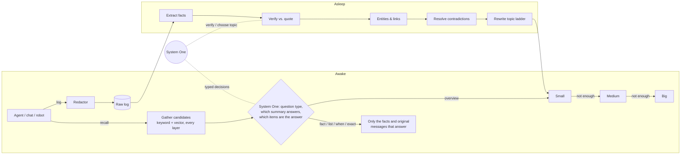
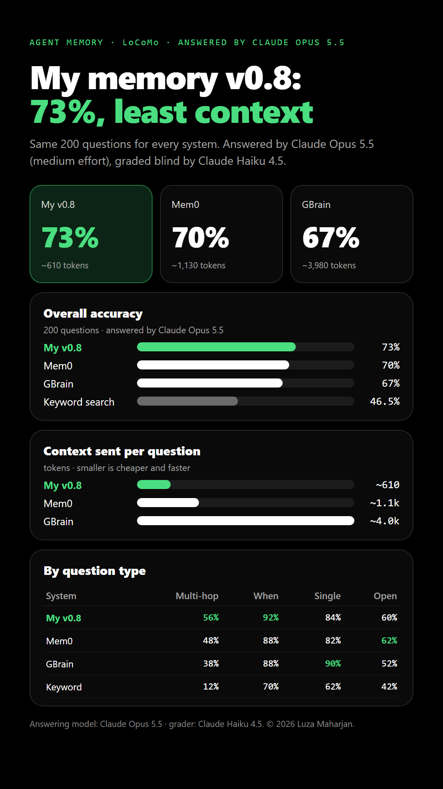

<div align="center">

# Hypnos

**Human-like long-term memory for AI agents. It notes everything, sleeps on it, keeps only checked facts, and shows the evidence for each one.**

[](hypnos/pyproject.toml)
[](integrations/claude-code/README.md)
[](CHANGELOG.md)
[](LICENSE)


[Install](#install-one-line) · [How it works](#how-it-works) · [Integrations](#integrations) · [Results](#results) · [Architecture spec](docs/architecture.html) · [Blog](https://agent-memory-architecture-chi.vercel.app/blog.html)

</div>

---

Hypnos gives any agent a memory that survives across sessions: coding agents, chat assistants, search and browsing agents, automation, and robots. Like a person, it notes everything during the day, sorts it into checked facts while it sleeps, and the next morning remembers what matters.

- **Grounded:** every fact cites the log line it came from, and a separate check confirms the line supports it.
- **Frugal:** most questions are answered from a ~60-token topic summary plus a few facts (~610 tokens per question on LoCoMo).
- **Current:** new facts replace outdated ones with validity windows and keep the history; code facts go stale when git shows the file changed.
- **Local-first:** SQLite on your machine; secrets are removed before anything is written; real deletes on request.
- **Light:** runs hidden in the background, only while an agent is open, and stops by itself ~90 s after the last one closes.
- **Plugs in anywhere:** Claude Code, opencode, Codex, Gemini CLI, Cursor, Windsurf, any MCP client, an OpenAI-compatible chat proxy, and Python adapters.

## Install (one line)

**macOS / Linux**
```sh
curl -fsSL https://agent-memory-architecture-chi.vercel.app/install.sh | sh
```

**Windows** (PowerShell)
```powershell
irm https://agent-memory-architecture-chi.vercel.app/install.ps1 | iex
```

The installer brings everything it needs (uv, and Python through uv), connects the coding agents it finds, asks which System One model and memory model to use, and starts the memory in the background with no windows. Restart your agent afterwards. Asking a coding agent to install it? Point it at [INSTALL.md](INSTALL.md); the steps for agents are at the bottom.

From a clone instead:

```bash
uv tool install --python 3.12 "./hypnos[mcp,vectors]"   # installs the `hypnos` command
hypnos setup                                             # connect agents, pick models
```

## Use it from Python

```python
from hypnos import Memory

mem = Memory(space="my-project", profile="coding")
mem.log("ran `pytest -q`: 3 failures in test_auth.py, token expiry checked before decode", role="tool")
mem.log("I prefer small, focused commits", role="user")      # stored as a fact immediately
mem.sleep()                                                  # consolidate: facts, topics, wake note
print(mem.recall("which tests failed and why?").context)
```

**Python is the main engine.** A Rust version of the v0.8 engine (same database and API, same accuracy, search 3.0 s vs 3.8 s) is kept frozen in [future/agentmem-rs](future/agentmem-rs/README.md); it is not maintained alongside Python.

## How it works

| Like a person | Hypnos |
|---|---|
| Notices everything during the day | every message and tool result is written to a raw log, instantly |
| Sleeps on it | when a session ends or goes quiet, a small model turns the log into short facts, each with the exact quote it came from; facts without evidence are dropped |
| Updates what it knows | a new fact that replaces an old one (a changed port, a new decision) retires the old one, with history kept |
| Remembers what matters | each new message gets only the memories it needs: a summary for broad questions, exact facts with quotes for precise ones |
| Forgets on request | `/memory-cleanup` shows duplicates, unused and stale facts by topic in under a second; delete by number or topic |



| Layer | What it holds | Size |
|---|---|---|
| Small | one or two sentences per topic, plus keyword anchors (exact paths, IDs, values) | ~60 tokens |
| Medium | working context: decisions, conventions, current state | ~300 tokens |
| Big | full picture: reasons, failed approaches, history | ~1,500 tokens |
| Original log | the topic's own log lines, word for word | ≤3,000 tokens |
| Facts | verified claims, each with a quote, date, entities and validity window | per fact |

It never saves an AI model's refusals ("the assistant can't do X"), never blocks your agent, and keeps each project's memory separate. Several sessions can run side by side; each knows what the others are doing and that their tasks are not its own.

The full design (rules R1–R15, the 20 typed decisions, parameters and a machine-readable JSON spec) is in **[docs/architecture.html](docs/architecture.html)**.

### System One model

Small yes/no and pick-one decisions (does this need memory, is this enough, does the quote support the claim, which topic, does the new fact replace the old one) go to a **System One model**, which answers in one fast step instead of writing text, 7–15× faster than an LLM in our runs.

- **Jev** (TypeSafe): hosted, needs a key.
- **Laya**: open weights, free, runs on your machine (`laya-serve`). Hypnos keeps it running while you use it, so memory costs nothing extra.
- **None**: the memory model you pick also makes these decisions while saving. Answers can be a little more accurate, but it uses more tokens.

### Memory model

Writing facts and summaries needs an LLM. Hypnos isn't tied to one: setup lists every model your machine can use (free opencode models, a local Ollama, Claude, Codex, and any OpenAI, DeepSeek, Gemini, OpenRouter, Mistral, Groq or xAI key) and suggests the best value, free and small models first. If one is down or out of quota, the next takes over. Sleep runs its steps in parallel; on machines with less than 12 GB of RAM it uses one writer at a time so your computer stays fast.

## Integrations

| Agent | How | Docs |
|---|---|---|
| **Claude Code** | hooks (wake, recall per prompt, log tools, sleep on compact/end), MCP tools, `/memory-cleanup` | [integrations/claude-code](integrations/claude-code/README.md) |
| **opencode** | plugin (`chat.message`, system transform, tool logging), MCP tools, `/memory-cleanup` | [integrations/opencode](integrations/opencode/README.md) |
| **Codex, Gemini CLI, Cursor, Windsurf** | MCP server plus instructions file (Codex `AGENTS.md`, Gemini hooks + `GEMINI.md`) | [integrations/coding-agents](integrations/coding-agents/README.md) |
| **Normal chat** | OpenAI-compatible proxy for any chat app or SDK | [integrations/chat](integrations/chat/README.md) |
| **Automation** | log steps and outcomes, recall before acting | [integrations/automation](integrations/automation/README.md) |
| **Robots** | `RobotMemory` (observations, actions, where-is) + ROS 2 node | [integrations/robotics](integrations/robotics/README.md) |
| **Search / browsing / custom agents** | `SearchMemory`, `BrowsingMemory`, `AgentMemory` | [integrations/agents](integrations/agents/README.md) |
| **Any MCP client** | `hypnos mcp`: recall, remember, note, correct, forget, sleep, status, cleanup | [integrations/claude-code](integrations/claude-code/README.md) |

`hypnos setup` wires all the coding agents it finds; `hypnos setup --uninstall` undoes everything.

## Results



**LoCoMo** (standard benchmark, 200 questions over 10 long conversations), answered by **Claude Opus 5.5**, every system's answers graded together and blind by **Claude Haiku 4.5**:

| System | Overall | Multi-hop | Temporal | Single-hop | Open-domain | Memory per question |
|---|---|---|---|---|---|---|
| **Hypnos v0.8** | **73%** | **56%** | **92%** | 84% | 60% | **~610 tokens** |
| Mem0 2.2 OSS | 70% | 48% | 88% | 82% | **62%** | ~1,130 tokens |
| GBrain 0.59 | 67% | 38% | 88% | **90%** | 52% | ~3,980 tokens |
| Keyword search | 46.5% | 12% | 70% | 62% | 42% | ~380 tokens |

**Version by version**, same 200 LoCoMo questions answered by a small free model (**Muse Spark 1.3**), graded by **Claude Haiku**. Compare rows within a run:

| Version | LoCoMo | Memory per question | What changed |
|---|---|---|---|
| v0.1, v0.2 | not measured | | designs on paper |
| v0.3 to v0.6 | v0.6: 41% | ~2,200 tokens | layered memory, sleep, verified facts, topic ladder |
| v0.7 | 53% | ~3,100 tokens | evidence-first recall; ahead of Mem0 (51%) and GBrain (51%) in the same run |
| v0.8 | 55% | ~600 tokens | System One routes each question to the smallest context that answers |
| v0.9 | 60.5% (v0.8: 60.5% in the same run) | ~611 tokens | one-line install, any agent, any model, fast cleanup, parallel sleep, runs only while an agent is open. A first try with extra date instructions scored 47% and was reverted. |

**On our own sessions** (60 questions from 15 real Claude Code sessions; Muse Spark 1.3 wrote, answered and graded):

| System | Accuracy | Tokens read / answer |
|---|---|---|
| **Hypnos v0.6** | **96%** | 3,531 |
| Hypnos v0.5 | 90% | 4,070 |
| Hypnos v0.4 | 87% | 3,457 |
| Hypnos v0.3 | 82% | 4,276 |
| Keyword search over raw logs | 90% | 2,258 |
| Rolling summary | 36% | 3,185 |
| Plain opencode searching the logs itself (24-question subset) | 92% | ~35,000 |

These are **in-sample**: v0.4–v0.6 were tuned on these questions. The session logs are private (they contain real work), so the harness is published without them.

Everything, including per-question LoCoMo results and how each run was measured: [docs/RESULTS.md](docs/RESULTS.md), the [benchmarks page](docs/benchmarks.html), the [benchmark harness](benchmark/) and the [blog post](https://agent-memory-architecture-chi.vercel.app/blog.html).

## Commands

```
hypnos setup            connect agents, pick models (--list-models, --memory-model, --uninstall)
hypnos cleanup          the /memory-cleanup list (--apply "1-5, T2")
hypnos mcp              MCP server (memory_recall, memory_remember, memory_note, cleanup tools, ...)
hypnos hook ...         hook handler for Claude Code and other agents
hypnos serve            the background service on 127.0.0.1:7439 (starts by itself)
```

## Repository layout

```
hypnos/           the Python package: engine, service, MCP server, CLI, setup wizard, adapters, tests
integrations/     setup for Claude Code, opencode, other coding agents, chat, automation, robots, custom agents
examples/         runnable examples (quickstart, custom agent, ROS 2 node)
install.sh        one-line installer for macOS / Linux
install.ps1       one-line installer for Windows
docs/             architecture spec, results, benchmarks page, blog, research review, images
benchmark/
  sessions/       the 60-question benchmark on real coding sessions (v0.3 to v0.6)
  locomo/         the LoCoMo benchmark: every run (v0.6 to v0.9, Mem0, GBrain, Opus, Rust) with per-question results
future/           agentmem-rs: the v0.8 engine in Rust, frozen for later (not maintained)
```

## Status and limits

This is a research preview. Known limits:
- the own-session evaluation is small and in-sample; LoCoMo is the fair comparison
- recall takes about 3–4 s per prompt (mostly System One round trips); ideas to speed it up are in [docs/improvements-for-review.txt](docs/improvements-for-review.txt)
- sleep costs LLM calls (about 0.8M tokens for 15 long sessions)
- entity resolution is by name only
- tested installs: Windows and Linux; macOS not yet tested

See [CHANGELOG.md](CHANGELOG.md), [SECURITY.md](SECURITY.md) and [CONTRIBUTING.md](CONTRIBUTING.md).

## License

Copyright (c) 2026 Luza Maharjan (GitHub: luzazzm-stack). All rights reserved. See [LICENSE](LICENSE).
